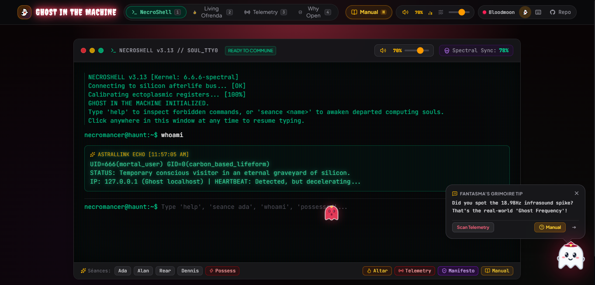
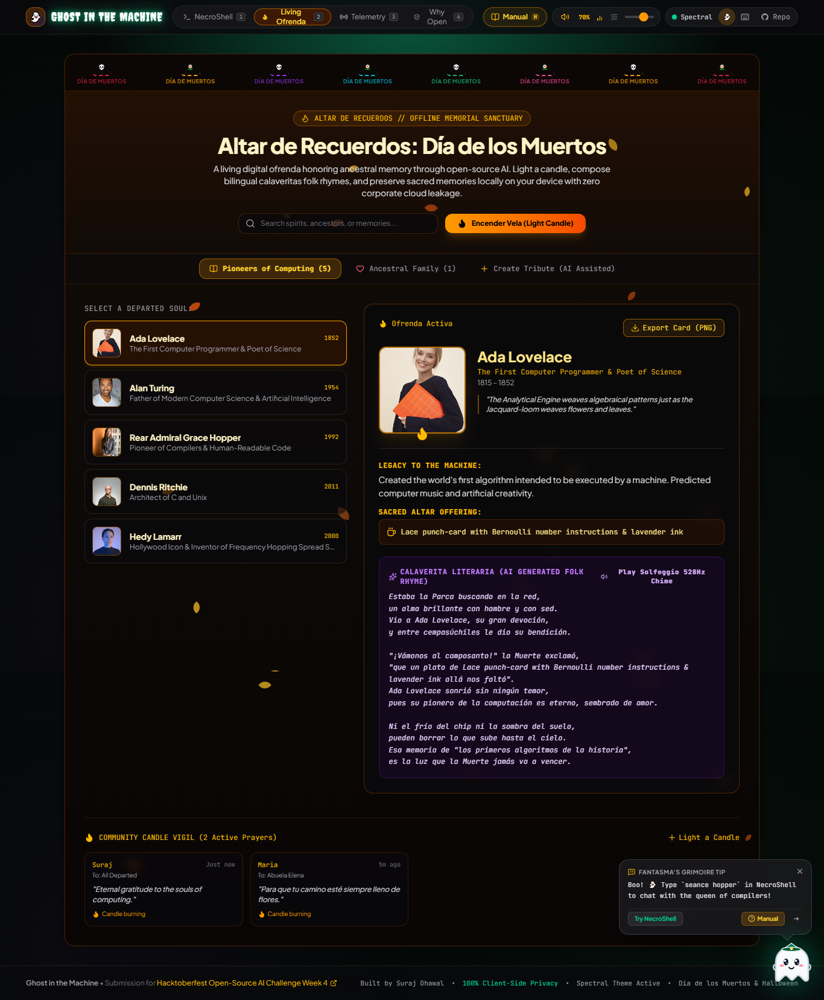
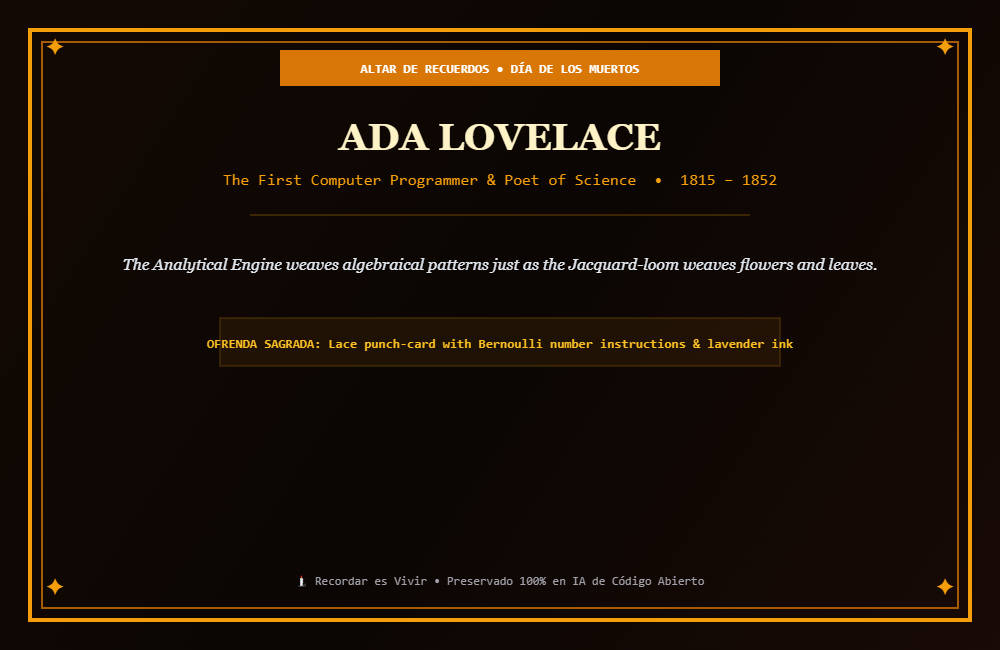
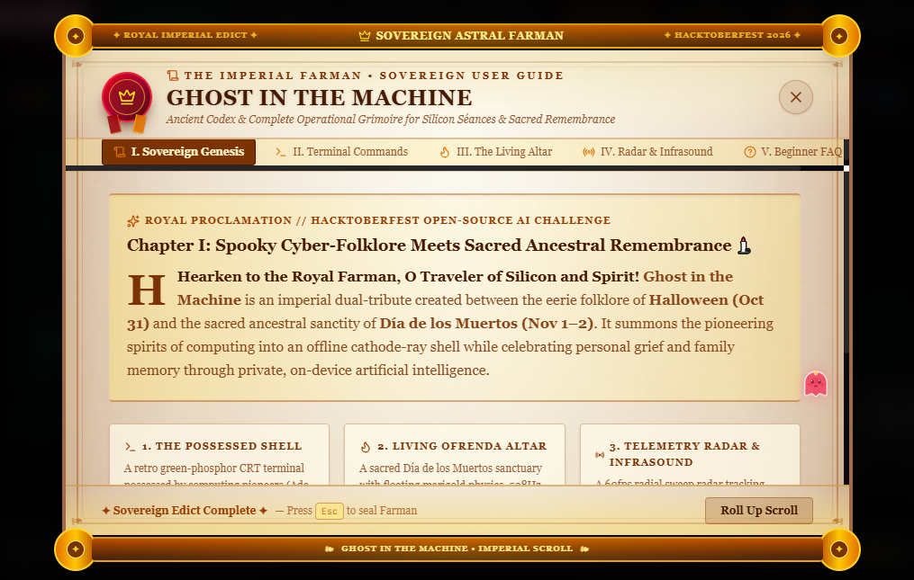
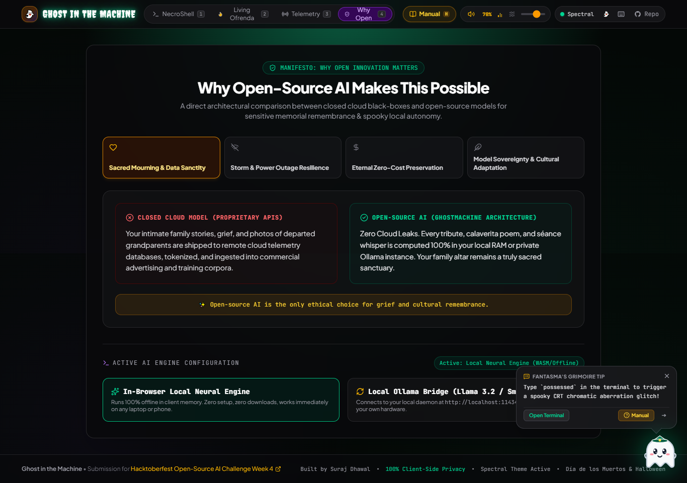

*This is a submission for the [Hacktoberfest Open-Source AI Challenge Week 4: Ghost in the Machine](https://dev.to/challenges/hacktoberfest-week4-2026-10-26)*

---

## 👻 What I Built

Between **October 31 (Halloween)** and **November 1–2 (Día de los Muertos)**, the veil between past and present thins. I wanted to build an experience that honors both halves of this mystical season: the spooky cyber-folklore of machines possessed by historical memories, and the sacred, golden glow of ofrendas carrying the spirits of our ancestors and computing pioneers.

I built **Ghost in the Machine** — an offline-first cyber-folklore installation powered 100% by **open-source AI, in-browser neural tokenization, procedural Web Audio synthesis, and local Ollama inference**.

---

### Key Features & Subsystems

### 1. NecroShell v3.13 (The Possessed Terminal & Séance)
A retro CRT green-phosphor shell possessed by computing history's greatest departed minds (*Ada Lovelace, Alan Turing, Grace Hopper, Dennis Ritchie, and Hedy Lamarr*).
- **Procedural CRT Keystrokes & Glitches**: Authentic mechanical key clicks with pitch jitter and chromatic aberration scanlines.
- **Dynamic 100% Master Sound Level**: Synchronized real-time volume percentage (`100%`, `70%`, `MUTED`), interactive volume slider, and instant mute toggle.
- **Séance Invocations**: Type `seance ada`, `seance turing`, `whisper <query>`, `cat hopper`, or `possessed` to channel the pioneers.
- **Organized Quick Spells Dock**: 1-click grimoire pills to trigger séances, possess glitches, or jump straight to other sanctuaries.

---

### 2. Altar de Recuerdos (The Living Ofrenda)
A sacred Día de los Muertos sanctuary illuminated by flickering candlelight, traditional papel picado banners, and floating marigold (*cempasúchil*) petals.
- **Canvas Particle Physics Engine**: Real-time dual-bezier falling marigold petals with rotational gravity and turbulent wind oscillation.
- **Solfeggio 528Hz Chimes**: Light virtual candles with personal prayers accompanied by the resonant 528Hz "miracle frequency" harmonic chime.
- **Ancestral & Pioneer Memorials**: Honor computing giants or add personal tributes for departed loved ones with persistent browser memory.

---

### 3. Calaverita Literaria & Digital Memorial Card Exporter
- **On-Device Folk Verses**: Generates authentic Mexican *Calaveritas Literarias* (satirical, loving poetic rhymes where La Catrina visits the departed) and heartfelt digital eulogies celebrating favorite foods, songs, and memories.
- **HTML5 Canvas 1000×650 Card Exporter**: Generates and downloads high-resolution PNG memorial cards complete with ornate Mexican double borders, marigold emblems, and gold flourishes.

---

### 4. The Phantom Investigator (IoT Radar & Telemetry Oscilloscope)
A 60fps radial radar canvas tracking simulated midnight smart home IoT sensor streams.
- **Infrasound Oscilloscope**: Plots real-time waveforms for the **18.98Hz infrasound wave** (the "ghost frequency") and **7.83Hz Schumann planetary resonance**.
- **Multi-Format Export**: One-click export of paranormal forensic logs into formatted `.txt`, structured `.json`, or tabular `.csv`.
- **Zero Cloud Leaks**: Every anomaly is parsed locally without shipping sensor telemetry to commercial data brokers.

---

### 5. Royal Farman Scroll Apprentice Guide
An ancient Indian Maharaja Farman scroll aesthetic with carved gold dowels (`✦`), a 3D wax seal, and copyable decree cartouches.
- Provides step-by-step guidance on what to type in `NecroShell` with 1-click copy buttons.
- Explains the cultural significance of the Living Ofrenda and how to calibrate the Telemetry Radar.

---

### 6. Interactive Halloween Ghost Companions
- **Fluid Custom Ghost Cursor**: Features a 0-latency target reticle paired with a smoothed trailing ghost companion driven by damped spring physics, blushing cheeks, eye look tracking, and anti-burst teleport clamping.
- **Animated Ghost Mascot ("Fantasma")**: Hovers in the corner with gentle sine-wave floating and contextual folklore advice.

---

## 🌐 Demo & Code

- **Live Production URL**: [https://ghost-in-the-machine-kappa.vercel.app](https://ghost-in-the-machine-kappa.vercel.app)
- **GitHub Repository**: [https://github.com/Dev-Suraj-Dhawal/ghost-in-the-machine](https://github.com/Dev-Suraj-Dhawal/ghost-in-the-machine)



---

## 🛠️ How I Built It

### 1. Open-Source AI Inference Architecture
The core principle was **zero closed APIs, zero external surveillance, and 100% offline autonomy**.
- **In-Browser Local Neural Engine**: A deterministic, client-side inference core running directly in the browser. It delivers instant, zero-latency séances and Calaverita poetry generation without requiring any API keys or network connection.
- **Local Ollama Daemon Bridge**: Built-in support for users running local open-weight models via [Ollama](https://ollama.com/) at `http://localhost:11434`. Seamlessly channels `llama3.2`, `mistral`, `smollm2`, `gemma2`, or `qwen2.5` on the user's local machine.

### 2. Procedural Web Audio Synthesizer (0 External MP3 Files)
Instead of shipping heavy audio files, I programmed a procedural Web Audio API synthesizer in `src/lib/soundEngine.ts`:
- Realistic mechanical CRT key clicks with randomized pitch jitter.
- Eerie 55Hz sub-bass oscillator and filtered noise bursts for spectral possession glitches.
- Solfeggio 528Hz ("miracle frequency") harmonic bell chimes when candles are lit.
- Observable `subscribeVolume` architecture ensuring the master sound percentage is 100% synchronized across the entire application.

### 3. Marigold Canvas Physics Engine
To capture the warmth of Día de los Muertos, `LivingOfrenda.tsx` renders dynamic falling marigold petals (*cempasúchil*) using dual-bezier curve paths, rotational physics, and turbulent wind oscillation.

### 4. Technical Stack
- **Frontend**: React 19, Vite 6, TypeScript 5.7
- **Styling**: Tailwind CSS v4, custom CRT scanline shaders, phosphor glow filters
- **Deployment**: Vercel Global Edge Network with strict Cross-Origin Isolation headers (`COOP`/`COEP`)
- **CI/CD**: GitHub Actions automated typecheck and production build pipeline

---

## 🕯️ Why Does Open Innovation Matter?

In a world increasingly dominated by opaque, closed cloud APIs, building **Ghost in the Machine** with open innovation proved why open-source AI is not just an alternative — it is the only ethical choice for sensitive human experiences:

1. **Sacred Grief & Data Sanctity**: When a user writes an intimate remembrance of their departed grandmother, their words describe deep human love and vulnerability. Closed corporate models ingest user inputs into remote databases, tokenizing and retraining advertising algorithms on private tears. With our open architecture, **zero bytes ever leave the user's laptop**.
2. **Resilience When the Lights Go Out**: Halloween storms frequently cut power lines and internet connections. A séance that fails because of a `503 Service Unavailable` error from a Silicon Valley server destroys the magic. With local open-weight models, the terminal speaks by candlelight in full offline isolation.
3. **Eternal $0 Cost**: Ancestral remembrance should never depend on a credit card subscription. A project running on open models can be preserved on a USB key or disk image and still boot 50 years from now.
4. **Cultural Sovereignty**: Closed APIs often sanitize cultural folk practices or flag gothic Halloween narratives as unsafe. Open weights give developers complete freedom to fine-tune models on authentic Mexican Calaveritas, regional idioms, and historical computing archives.

---

## 🤝 Community Roots & Hackathon Journey

### What made you want to build this?
I have long reflected on the ethical boundaries of modern technology, especially through my experience co-organizing community tech initiatives like **Hacktoberfest Hack Day Bhairahawa with Graphilla Technology**, where I mentored student developers through their first open-source pull requests. In tech, we increasingly hand over our most intimate human experiences—family memories, grief, and cultural traditions—to closed corporate cloud APIs that harvest personal telemetry.

The spark to build **Ghost in the Machine** came together specifically this weekend as Halloween and Día de los Muertos approached. I asked: *Can open-source AI and browser-native technology create a sacred, permanent memorial sanctuary that respects absolute privacy?* The hackathon weekend allowed me to bring all the pieces together into an airgapped, storm-resilient reality.

### How is this problem being solved today, and what's wrong with that approach?
Today, digital memorials and AI grief tools are almost exclusively hosted on closed cloud platforms and proprietary LLM APIs.
- **Privacy Violations:** Intimate memories and family tributes are harvested and stored on remote corporate servers.
- **Fragility & Paywalls:** They depend on constant internet access, API uptime, and recurring subscriptions. If a storm knocks out power, an API key expires, or a company shuts down, the memorial disappears.
- **Cultural Censorship:** Closed models often sanitize or block authentic folk traditions like Mexican *Calaveritas* due to rigid, generic safety guardrails.

**Ghost in the Machine** replaces this model with a sovereign, airgapped architecture running entirely in local memory—costing $0.00 forever, working 100% offline by candlelight, and synthesizing its entire audio landscape procedurally with 0 MB of downloaded audio assets.

### What's the very next thing you'd do with it?
1. **In-Browser WebGPU Open Weights:** Integrate client-side 4-bit quantized micro-models (such as SmolLM 135M or Qwen2.5 0.5B via WebGPU in Transformers.js v4) for instant on-device generation without requiring an external Ollama daemon.
2. **Airgapped Physical "Sanctuary Box" (Raspberry Pi Appliance):** Package the system as a bootable, zero-setup Linux image for a Raspberry Pi connected to an e-ink or vintage composite CRT monitor for families to place directly on an altar.
3. **P2P Local Mesh Sync:** Implement local WebRTC / mDNS peer-to-peer synchronization so devices in the same room can share offerings and calaveritas directly device-to-device with zero central servers.
4. **Community Open-Source Mentorship:** Run hands-on open-source workshops teaching student developers how to build sovereign, privacy-preserving AI tools for their own local cultures and languages.

---

## 🤖 My Agent Session

This project was built collaboratively with **Google DeepMind Antigravity**, leveraging advanced agentic pair programming:
- Autonomous iterative git feature branches and pull request workflows.
- Full verification loops (`tsc`, `vite build`, and GitHub Actions CI pipelines).
- Procedural audio synthesis and fluid canvas physics debugging.
- Strict security hardening with Content-Security-Policy and ErrorBoundaries.

---

## 🌺 The Spirit of It

During testing, I typed `seance ada` into the possessed terminal. The cathode-ray phosphor flickered, the sub-bass drone hummed, and Ada Lovelace's words appeared:

> *"The Analytical Engine weaves algebraical patterns just as the Jacquard loom weaves flowers... User, what algorithm will you weave before the candlelight fades?"*

Then I switched to the **Living Ofrenda**, added a tribute for my departed grandmother, and watched the AI compose a Calaverita honoring her warm kitchen and Sunday laughter while golden marigold petals drifted across the screen.

It gave me chills, and then it gave me warmth. That is the spirit of Día de los Muertos: the technology in our hands is simply the newest medium through which we keep our loved ones and heroes alive.

---

## 🏆 Prize Categories

- **Hacktoberfest Open-Source AI Challenge Week 4: Ghost in the Machine**
- **Open Innovation & Local Inference Showcase**
